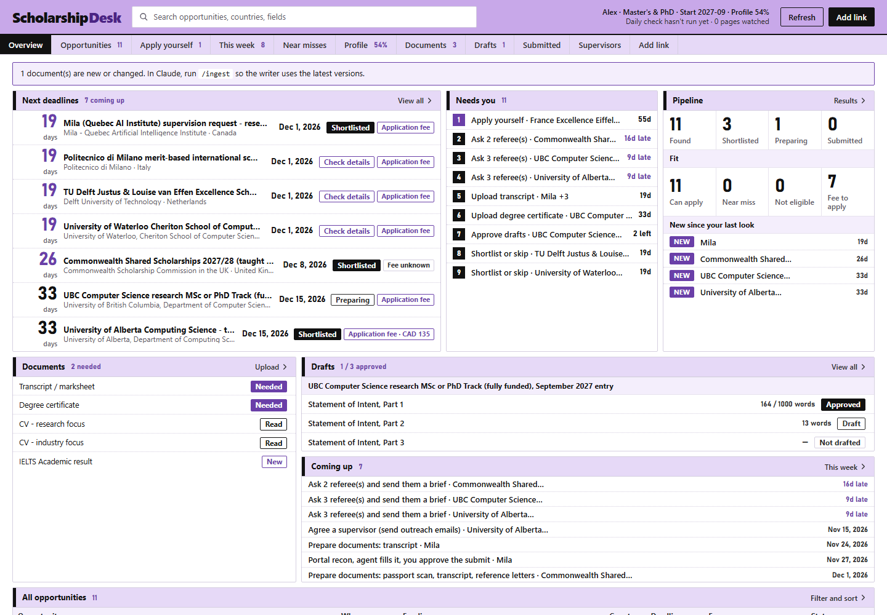
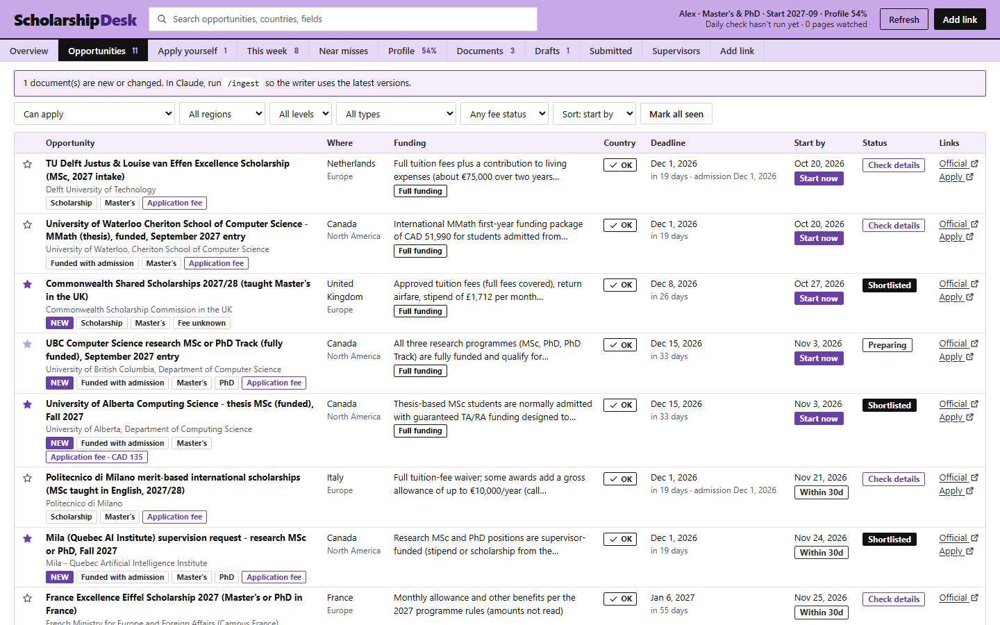
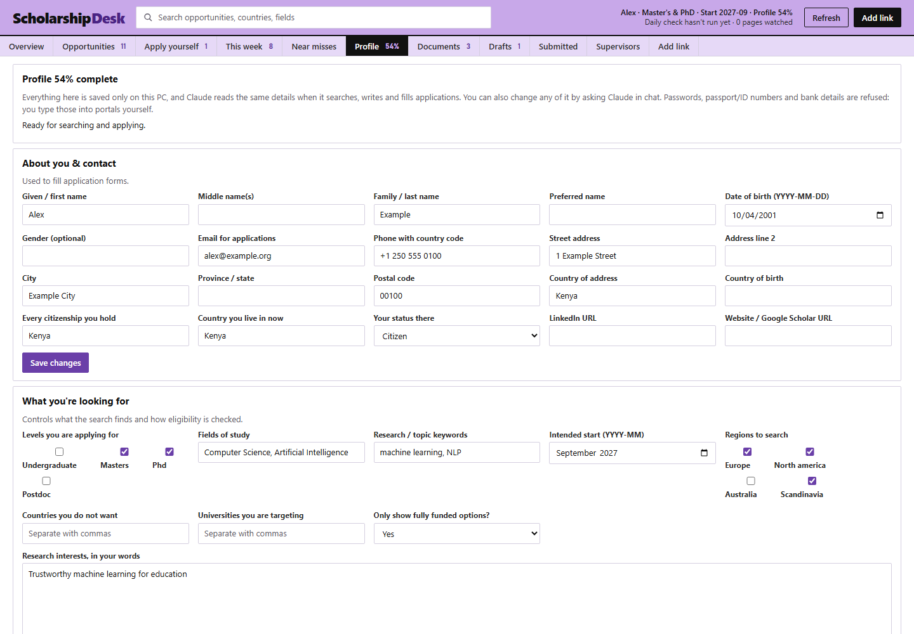
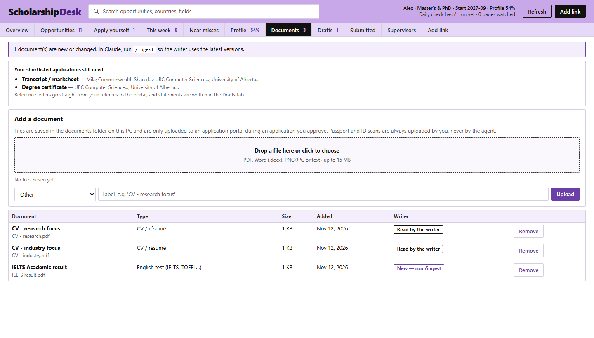
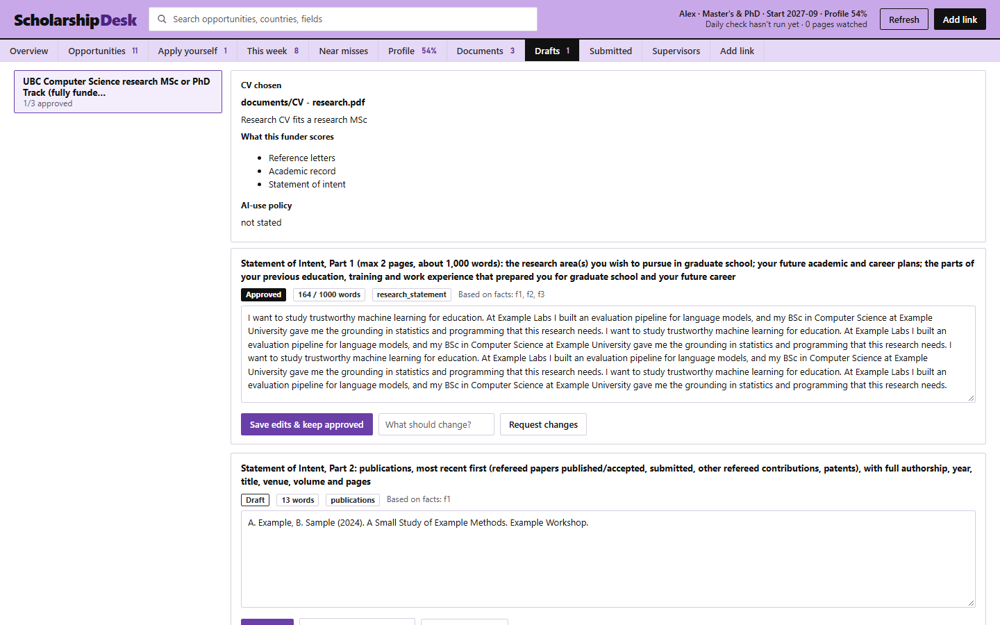
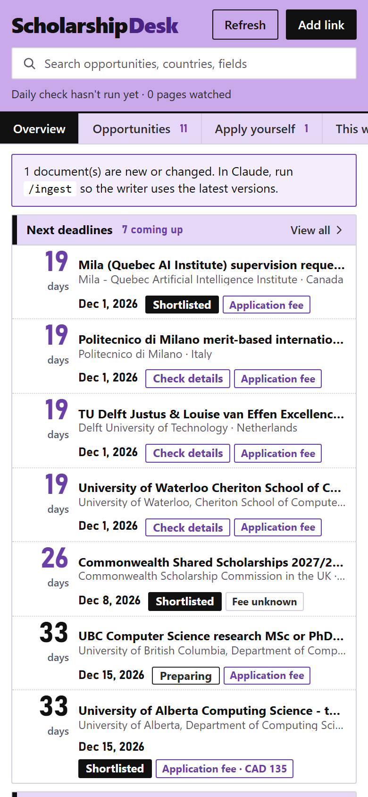

# Scholarship Desk

**Find funded master's and PhD places abroad, check that you're actually eligible, and apply on time,
with Claude doing the searching, writing and form-filling while you stay in charge.**

It looks for scholarships, funding that comes with admission, and salaried PhD positions in
**Europe, Canada, the US, Australia and the Nordic countries**. It runs on your own computer with
**Claude Code** and your normal Claude subscription. There's no API key, no server and no extra cost.



<sub>All screenshots use a made-up applicant ("Alex Example") and public funder information.</sub>

---

## What it does for you

- **Finds opportunities** on official university and funder websites (listing sites only count as leads).
- **Checks your eligibility honestly.** It compares your citizenship and where you live against the
  funder's exact country list, along with your degree, test scores, work experience and age. You see the
  funder's own words next to every verdict. If you're close but missing something, it goes under **Near misses**.
- **Plans backwards from deadlines.** Each opportunity gets a "start by" date and a task list: ask
  referees, book an English test, gather documents, write answers.
- **Labels fees.** Each opportunity shows *Application fee* or *No fee*. If a *scholarship* asks for
  money to apply, or it's really a loan or a lottery, it's thrown out as a likely scam.
- **Writes your answers** from your own CVs and documents, in your voice, within word limits, and
  waits for you to approve them.
- **Fills in the real application website** in your Chrome. It stops for logins, CAPTCHAs and ID
  numbers, and only clicks *Submit* after you say **yes**.
- **Keeps track** of what you've submitted and what happened, so it learns which CVs and answers work.

## What you need

| | |
|---|---|
| **Claude Code** | The Code tab in the Claude desktop app, or `claude` in a terminal, on a paid Claude plan. |
| **Claude in Chrome** | The browser extension. It's only needed if you want Claude to fill in application websites for you. |
| **Python 3.10 or newer** | From [python.org](https://www.python.org/downloads/). On Windows, tick *"Add python.exe to PATH"*. |
| **Your documents** | CVs (every version you have), transcripts, degree certificates, English test results, past essays. |

## Set it up (about 15 minutes)

**1. Get the code**

```bash
git clone https://github.com/rafaym1/scholarship-desk.git
```

You can also download the ZIP and unzip it.

**2. Run the setup**

*Windows* (PowerShell, inside the folder):

```powershell
powershell -ExecutionPolicy Bypass -File .\setup.ps1 -DailyWatch
```

This creates your private folders and a **Scholarship Desk** shortcut on your desktop. It also sets up a
safety check that stops your CVs from ever being committed to git, and a free daily check of
scholarship pages at 08:00 (drop `-DailyWatch` if you don't want that). It also installs `tzdata`, the
time zone data Windows lacks, so deadlines are checked in each funder's own time zone.

*Mac or Linux* (terminal, inside the folder):

```bash
mkdir -p data/tmp documents submitted playbooks
git config core.hooksPath .githooks
python3 -m pip install --user pypdf
python3 -m scholar status
```

The `pypdf` step is optional. It lets the tool count PDF pages exactly. The last line is a quick
self-test: it should print JSON with `"ok": true`. On Mac and Linux, type `python3` wherever this
page says `python`.

For the free daily check of scholarship pages, run `crontab -e` and add this line, with your
own folder path:

```
0 8 * * * cd /path/to/scholarship-desk && python3 -m scholar watch run >> data/watch.log 2>&1
```

If cron can't find `python3`, use the full path that `which python3` prints.

**3. Open the folder in Claude Code**

Open this folder in the Claude desktop app's Code tab, or run `claude` inside it.

**4. Open the dashboard**

Double-click the **Scholarship Desk** shortcut (Windows) or run:

```bash
python -m scholar serve --open
```

On Mac and Linux, use `python3 -m scholar serve --open`.

The dashboard is a web page that only runs on your computer (`http://127.0.0.1:8765`). Nobody else
can see it.

## Your first run

You can do steps 1–2 on the web page or by chatting with Claude. Both save to the same files.

1. **Tell it about yourself.** Fill in the **Profile** tab, or type `/profile` in Claude and answer its
   questions. It needs your citizenship(s), the country you live in, your education, test scores,
   experience and referees, plus what you want to study and where.
2. **Add your documents.** Drag them onto the **Documents** tab, or put them in the `documents` folder.
3. **Let Claude read them.** Type `/ingest` in Claude. It reads your documents once and builds a "fact
   bank" of your achievements, which every answer it writes is based on. It never makes facts up.
4. **Search.** Type `/discover` in Claude. It searches official sources in your chosen regions, checks
   each result against your profile, and fills the dashboard.

Then open the dashboard and start with the **Overview**.

## The dashboard, screen by screen

### Overview: everything at a glance

The first screen shows:

- your **next deadlines** with days left
- **Needs you**: numbered, concrete jobs such as "Ask 3 referees · UBC" or "Upload transcript · Mila"
- your **pipeline** (found → shortlisted → preparing → submitted)
- **new finds** since your last look
- which **documents** are still missing
- the state of every **draft** answer
- the **tasks coming up**

Click any row to jump to the details. The screenshot is at the top of this page.

### Opportunities: the full list, filtered and sorted



Each row shows what the funding covers, whether your country is eligible (**OK**), the deadline,
the **start by** date, the fee label and links to the official page and the application.

- Click a row to see the requirements, the eligibility reasoning in the funder's words, the task
  timeline and the buttons.
- **☆ star** or **Shortlist** what you want, and **Dismiss** what you don't.
- **Copy command** gives you the exact `/tailor` or `/apply` line to paste into Claude. Which one
  depends on how far along that application is.

The other list tabs show subsets of this list:

- **This week**: tasks due in the next 7 days
- **Near misses**: almost eligible, with what's missing
- **Apply yourself**: places the agent can't apply for you, with the reason and the link

### Profile: edit everything about you



Every detail can be edited here: contact details, citizenships, targets, regions, education, tests,
experience, publications, awards, activities, referees, languages and where you've lived. Changes are checked the same way as in chat.
Passwords, passport/ID numbers and bank details are refused on purpose, because you type those
into application websites yourself.

### Documents: upload once, reuse everywhere



Drop in PDFs, Word files, images or text (up to 15 MB each). The box at the top lists what your
shortlisted applications still need. New files are marked **New — run /ingest** until Claude has read them.

### Drafts: approve what Claude wrote



For each application you see which CV Claude chose and why, what the funder scores, and every answer
with its word count against the limit and the facts it was based on. **Approve** it, edit it and
save, or type what should change and click **Request changes**. Nothing is submitted with an
unapproved answer.

### Other tabs

| Tab | What it shows |
|---|---|
| **Submitted** | What you've submitted, the confirmation number and a saved copy. Record the outcome (interview, offer, rejected) here. |
| **Supervisors** | Matching professors found by `/outreach`, with draft emails for you to send. |
| **Add link** | Paste a link you found anywhere and it's checked on the next daily run. |

### Fits narrow windows too



Put the dashboard beside Claude or an application website in half your screen and it rearranges
itself into one column.

## Ways to use it

Pick whichever suits you. You can mix them freely.

### 1. Mostly on the web, Claude for the heavy lifting

Use the dashboard for everything you *give*: your profile, documents, approvals, shortlists and
links. Use Claude only for the four jobs that need it: `/ingest`, `/discover`, `/tailor <id>` and
`/apply <id>`. The dashboard's **Copy command** buttons give you those lines ready to paste.

### 2. Entirely in chat

Prefer talking? Everything works in Claude too. Examples:

- "My IELTS came back, 7.5 overall", and it updates your profile.
- "What's due this week?"
- "Shortlist the Delft and Alberta ones."
- "Make the motivation answer for UBC shorter."

### 3. "I found a link, is it any good?"

Type `/discover <link>` in Claude. It opens the official page, runs the scam and fee checks, checks
your eligibility, and adds the result to your list. Not urgent? Put the link in **Add link** and it's
handled on the next daily run. Or type `/apply <link>` to go straight to applying.

### 4. Let it watch for you

The daily check (set up with `-DailyWatch`) re-reads saved funding pages every morning for free,
without using any Claude. When something changes, `/discover daily` in Claude processes only the
changes, which costs very little. Do a full `/discover` once a week. You can ask Claude to schedule
both as recurring tasks.

### 5. Apply with the agent

For one opportunity, do these in order:

1. `/recon <id>` walks the application website **without submitting**. It notes every question,
   word limit and upload rule.
2. `/tailor <id>` writes the answers. Approve them in **Drafts**.
3. `/apply <id>` fills in the website in your Chrome. When it needs you (to log in, solve a CAPTCHA,
   pay the application fee, enter your passport number), it stops and tells you exactly what to do.
   Then it shows you a review of everything it entered and waits for your **yes**.

Some places can't be done by the agent: nomination-only awards, applications sent by email or PDF,
and websites that block automation. Those land in **Apply yourself** with everything prepared.

### 6. Research degrees: find a supervisor first

For research master's and PhDs (common in Canada, Australia and the UK), type `/outreach` or
`/outreach <id>`. It finds professors whose recent work matches yours and drafts short, specific
emails. **You** send them, because Claude never emails anyone for you.

### 7. Just as a deadline tracker and eligibility checker

You don't have to use the agent at all. Many people only use the search, the eligibility checks
and the deadline planning, and then apply by hand. Click **I applied myself** to keep the
tracker accurate.

## A typical week

1. **Monday:** open the Overview and work through **Needs you** from the top.
2. Shortlist the new finds that fit, and dismiss the rest.
3. Run `/tailor` on the next shortlisted opportunity and approve its drafts during the week.
4. Run `/apply` when its tasks are done. One application per Claude conversation works best.
5. **Weekend:** run `/discover` for the weekly search.

## What you always do yourself

These are never done for you, on purpose:

- logging in and creating accounts
- passwords and verification codes
- CAPTCHAs
- passport, national ID and SIN/SSN numbers
- bank and card details, and **any payment** (such as university application fees)
- e-signatures
- uploading ID documents
- the final **yes** to submit
- sending emails to professors or referees

Claude also won't accept terms and declarations without quoting them to you first. It ignores any
instructions it finds written on web pages or in PDFs, and points them out to you.

## Your data stays yours

- Your profile, documents, drafts and records live in `data/`, `documents/` and `submitted/` on your
  computer. Those folders are **never committed to git**, and a safety check blocks CVs and PDFs as well.
- Your details only go into the application website you're filling in, and only during an
  application you approved.
- The dashboard only listens on your own computer (`127.0.0.1`).
- If you share the repository, you share only the code and `playbooks/`: notes on how application
  websites work, with no personal data. Each person runs their own copy with their own profile and
  Claude plan.

## Keeping within your Claude plan's limits

- Use **Sonnet** for `/discover`, `/recon` and `/apply`. **Opus** is worth it for `/tailor`, where
  the writing quality matters.
- One application per conversation.
- The free daily check plus `/discover daily` is cheap. The weekly full search is the expensive part.

## Handy commands

These run in a terminal inside the folder. They're free and use no Claude.

```
python -m scholar serve --open           open the dashboard
python -m scholar status                 quick overview
python -m scholar week                   tasks due this week
python -m scholar profile status         what's missing from your profile
python -m scholar opp list               opportunities and verdicts
python -m scholar watch run              run the free page check now
python -m scholar registry check         find moved or broken official links
python -m unittest discover -s tests     run the tests
```

Every command prints JSON. On Mac and Linux, use `python3`. On Windows, use `py` if that's how Python is installed.
If port 8765 is busy, use `python -m scholar serve --open --port 8766`.

## How it's built

```
Claude Code skills                       Dashboard (your browser)
  /profile /ingest /discover               http://127.0.0.1:8765
  /recon /tailor /apply /outreach          Overview · Opportunities · Profile · Documents · Drafts …
              \                           /
               python -m scholar  (rules, checks, timeline: plain Python, no AI)
                          |
               data/  documents/  submitted/   (private, on your computer)
```

The judgement calls are plain, tested Python code rather than AI guesses. That covers eligibility,
country rules, fees, deadlines, word limits, document checks, and the approval gates that stop the
agent from submitting early. Claude does the reading, searching, writing and clicking. You can
change how early tasks start in `data/lead_times.json`, for example `{"references": 49, "language_test": 42}`.

## Limits

- It only finds what official sources publish, and coverage grows as more sources are added.
- Some application websites block automation or are too fiddly. Those fall back to you, with the link.
- Rules and deadlines change every year. Records older than 14 days are re-checked, and the agent
  re-reads the official page before applying.
- It helps you apply. It isn't advice, and it never guesses your chances of winning.

## Please read before you rely on it

- **It isn't official.** Scholarship Desk isn't connected to, or endorsed by, any university,
  government or funder named in it or found by it.
- **It can be wrong.** Eligibility results, deadlines, fees and requirements come from web pages that
  change, and from automated reading that can make mistakes. Always check the funder's official page
  before you decide or apply.
- **You're responsible for your applications.** It only submits after your explicit yes, so check
  everything in the review before you give it. That includes every fact, answer and document.
- **Follow each funder's rules on AI.** Some funders limit or ban AI-written essays. `/tailor` looks
  for the funder's policy and tells you what it found, but reading and following the rules is up to you.
- **Respect each website's terms.** Some application websites don't allow automated use. Fill those
  in yourself (they appear under **Apply yourself**), and keep to your own accounts.
- **Your data is your responsibility too.** It stays on your computer, so keep that computer and
  your backups safe.

## License

[MIT](LICENSE). You can use it, change it and share it freely. It comes with no warranty.
